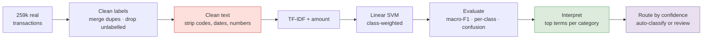

# Categorising Noisy Bank Transactions (Open Banking Style)

Open Banking lending rests on one unglamorous capability: taking a feed of noisy, real-world transaction strings and reliably sorting them into categories (income, groceries, loans, utilities, and so on). This project does exactly that, on **259,000 real bank transactions**, treated as the multi-class, imbalanced, messy-text problem it actually is, and taken all the way to a production-style routing decision.

---

## Results at a glance

| Model (on transaction text) | Accuracy | Macro-F1 |
|---|---|---|
| Most-frequent baseline | 0.125 | 0.007 |
| Complement Naive Bayes | 0.837 | 0.743 |
| Logistic (SGD) | 0.817 | 0.702 |
| **Linear SVM** (chosen) | 0.880 | 0.774 |
| **Linear SVM + amount** (final) | **0.907** | **0.797** |

- From raw strings alone, the model learns sensible merchant signals: *mcdonald / starbucks* to **Restaurants**, *kroger / publix* to **Supermarkets**, *uber / lyft* to **Payroll** (gig income), with no hand-coded rules.
- Ranked by confidence, **auto-classifying the most-confident 80% of transactions reaches 98% accuracy**, leaving a small minority for review.

---

## How it works



Why these choices:

- **Macro-F1, not accuracy.** With 31 imbalanced categories, accuracy is dominated by the common classes; macro-F1 forces the model to be judged on the rare ones too.
- **Real label cleaning.** An exact duplicate (`Bank Fee` vs `Bank Fees`) is merged, and an `Uncategorized` bucket plus genuinely missing labels are dropped rather than predicted.
- **Aggressive text cleaning.** Auth codes, dates and account numbers are stripped so the model keys on merchant words, not noise. For example, `Earnin  PAYMENT  [name removed]` becomes `earnin payment [name removed]`.

---

## 1. The category distribution is heavily imbalanced


A handful of categories (third-party payments, restaurants, transfers, loans) carry most of the volume, while a long tail (telecoms, gyms, tax refunds) is rare. This shape is exactly why macro-F1 is the metric to watch: a model could score well on accuracy while ignoring the tail entirely.

## 2. Amount is a useful second signal


Text is the main signal, but transaction value helps separate categories the words alone might blur: payroll and loan transactions are large, restaurant and grocery transactions are small. The final model adds amount as a feature for exactly this reason.

## 3. Which classifier, and why


Three linear classifiers on the description text alone. The **linear SVM wins on macro-F1** (0.77, versus 0.74 for Complement Naive Bayes and 0.70 for an SGD logistic model), which is why it is carried forward. Adding transaction amount then lifts the final model to **0.80**. All three sit far above the 0.01 baseline; the question is which generalises best across the rare categories, and the SVM does.

## 4. Per-category performance, in full


The model is near-perfect on distinctive categories (Interest, ATM, Bank Fees, Third Party, all around 0.99) and weak on fuzzy or rare ones (Service 0.39, Healthcare 0.41, and Tax Refund 0.00, which has only five examples in the whole dataset). An aggregate accuracy would mask these weak classes, so they are shown explicitly. The pattern is intuitive: categories with a clear merchant vocabulary are easy, semantically broad ones are hard.

## 5. Where it confuses categories


The confusions are the ones you would predict: the various transfer types (transfer, transfer credit, transfer debit) blur into each other because their descriptions genuinely overlap, and broad retail categories trade places. Almost none of the error is nonsensical, which is a good sign that the model is learning real structure rather than noise.

## 6. What the model actually learned


The top-weighted terms per category are exactly the merchant names a human would use: Restaurants keys on *mcdonald, starbucks, dunkin*; Supermarkets on *kroger, publix, safeway*; Payroll on *payroll, direct dep*, and tellingly on *uber, lyft* (gig income); Utilities on *energy, water, electric*. This is the interpretability that matters for a transaction engine: you can see, and defend, why any transaction was categorised the way it was.

## 7. The production view: auto-classify the confident, review the rest


A categorisation engine does not have to label every transaction automatically. Ranking predictions by the model's confidence (the gap between its top two class scores), the most-confident transactions are almost always right:

| Auto-classify the most-confident | Accuracy on those | Sent to review |
|---|---|---|
| 70% | 99.2% | 30% |
| 80% | 98.2% | 20% |
| 90% | 96.0% | 10% |

That is how a system like this runs in practice: high-confidence transactions flow straight through, the uncertain minority gets a second look.

---

## A note on the data

The transaction descriptions are clearly **real**: authentic bank-feed formatting, real merchant and app names, embedded authorisation codes. The category labels match the Plaid / Open Banking taxonomy. However, the source repository does **not** document where the data came from, so its **provenance is unverified**. It is treated here as a realistic, real-derived dataset, not a citable benchmark. For any use beyond a portfolio exercise, its origin and licensing would need to be established first.

## Data licence

The **code** here is MIT-licensed (see `LICENSE`). The **data's provenance is undocumented** in its source, so no data licence can be asserted; it is included for demonstration only and should not be redistributed or used in production without establishing its origin and terms.

---

## Run it

```bash
pip install -r requirements.txt
python analysis.py                        # reproduces all seven figures
# or open the narrative version:
jupyter notebook transaction_classification.ipynb
```

## Repo structure

```
.
├── transaction_classification.ipynb   # narrative analysis (executed, 7 figures)
├── analysis.py                         # same analysis as a script
├── README.md
├── LICENSE
├── requirements.txt
├── data/                               # the transaction dataset
└── figures/                            # generated charts
```

---

## Limitations

- **Unverified provenance.** The descriptions are clearly real, but the source does not document the data's origin, so this is real-derived, not a citable benchmark.
- **Labels are aggregator-assigned**, so the model learns to reproduce a categorisation engine's output, not an independent ground truth.
- **Label noise and overlap** remain (several near-synonymous transfer and retail categories).
- **Narrow window** (four months, 880 mostly US-style accounts), so merchant and category coverage is partial.
- **A linear baseline by design.** Production categorisation uses transformers over transaction text; this is the interpretable model to beat.

*Built as a portfolio project. Data provenance is unverified and stated as such.*
