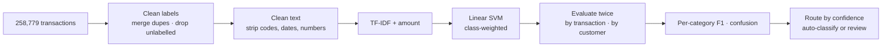
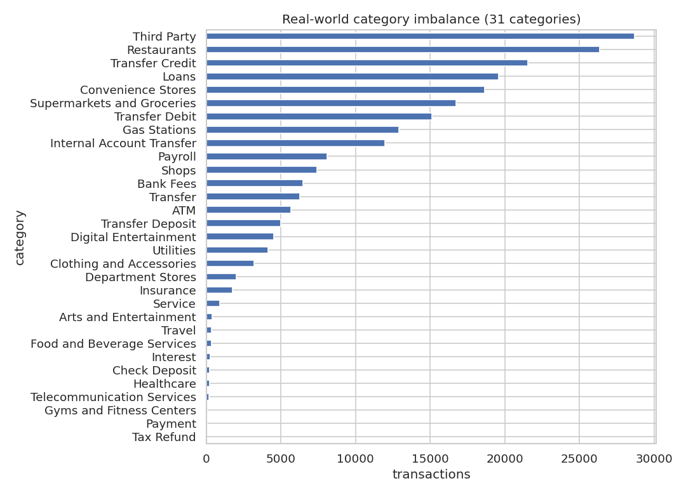
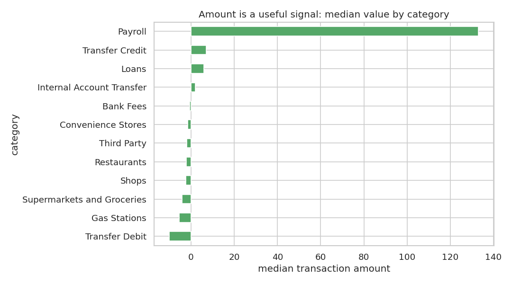
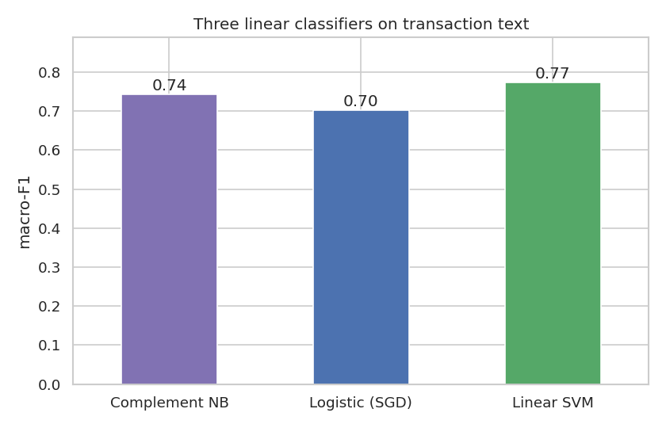
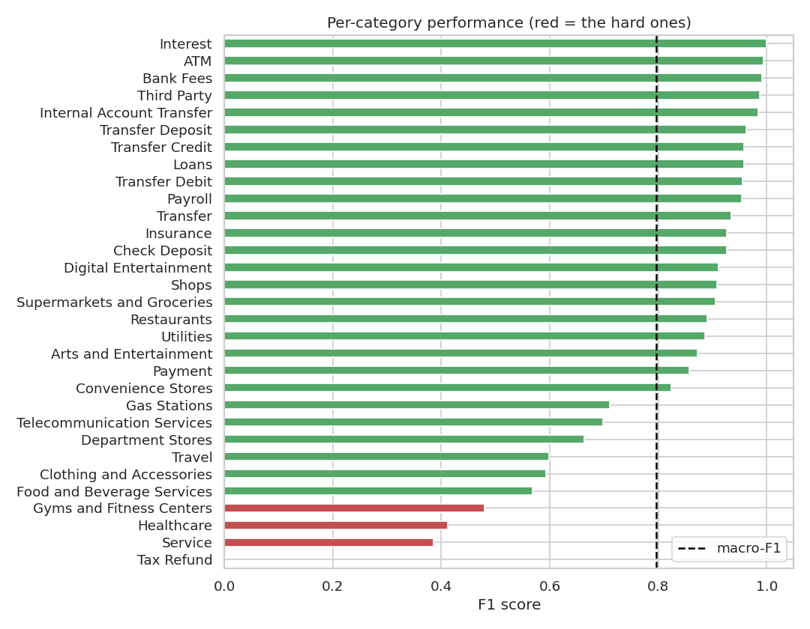
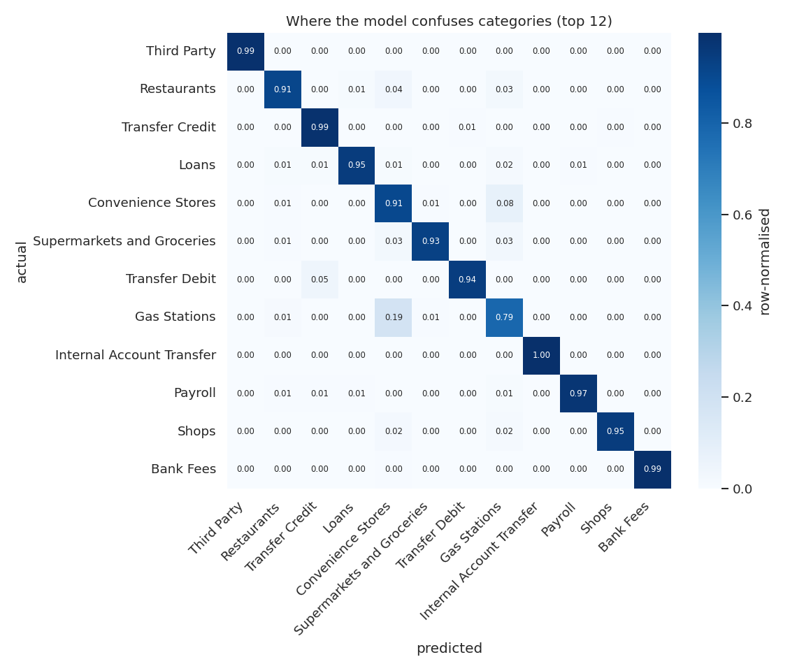
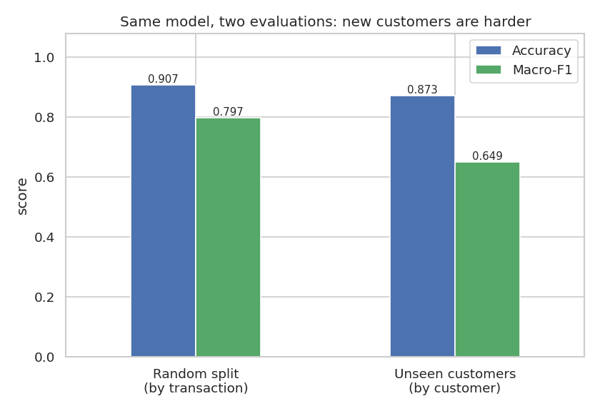
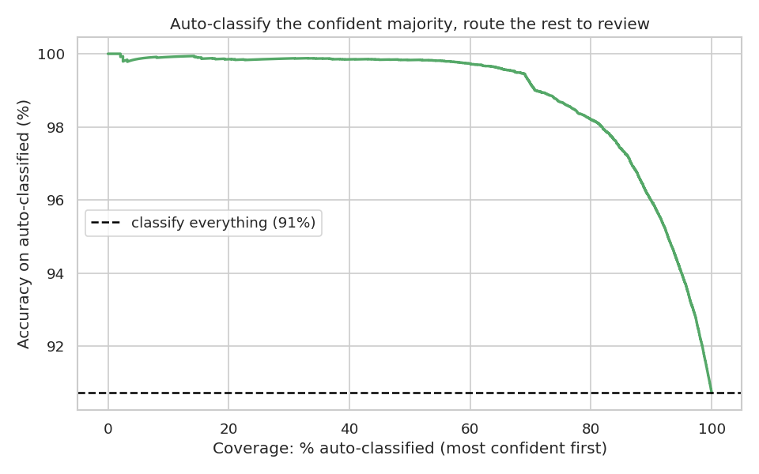

# Categorising Noisy Bank Transactions (Open Banking Style)

[](https://github.com/gbadedata/transaction-classification/actions/workflows/tests.yml)

Open Banking lending rests on one unglamorous capability: taking a feed of noisy, real-world transaction strings and reliably sorting them into categories (income, groceries, loans, utilities, and so on). This project does that on **258,779 real bank transactions** (229,130 with usable labels, 31 categories, 880 customers), treats it as the multi-class, imbalanced, messy-text problem it is, and takes it through to a production-style routing decision. It then asks the question that matters for deployment: **how well does it work on customers it has never seen?**

---

## Results at a glance

**Random split by transaction** (the standard evaluation):

| Model | Accuracy | Macro-F1 |
|---|---|---|
| Most-frequent baseline | 0.125 | 0.007 |
| Complement Naive Bayes (text) | 0.837 | 0.743 |
| Logistic (SGD) (text) | 0.817 | 0.702 |
| Linear SVM (text) | 0.880 | 0.774 |
| **Linear SVM + amount** (final) | **0.907** | **0.797** |

**Split by customer**: the same final model, tested on 220 customers (16,088 transactions) whose transactions it never saw in training:

| Model | Accuracy | Macro-F1 |
|---|---|---|
| **Linear SVM + amount** | **0.873** | **0.649** |

- The model learns sensible merchant signals with no hand-coded rules: *mcdonald / starbucks* for **Restaurants**, *kroger / publix* for **Supermarkets**, *uber / lyft* for **Payroll** (gig income).
- Auto-classifying the most-confident 80% of transactions reaches **98.2% accuracy** on the random split and **96.7% on unseen customers**.
- Accuracy holds up for new customers; **macro-F1 drops from 0.80 to 0.65**, because the rarer categories depend heavily on a few customers. The random split overstates how well the long tail generalises. Section 7 explains why.

---

## How it works



Why these choices:

- **Macro-F1, not accuracy.** With 31 imbalanced categories, accuracy is dominated by the common classes; macro-F1 judges the model on the rare ones too.
- **Real label cleaning.** An exact duplicate (`Bank Fee` vs `Bank Fees`) is merged, and an `Uncategorized` bucket plus missing labels are dropped rather than predicted.
- **Aggressive text cleaning.** Auth codes, dates and account numbers are stripped so the model keys on merchant words, not noise. For example, `POS PURCHASE 0412 STARBUCKS #1234 SEATTLE WA 06/14` becomes `pos purchase starbucks seattle`.
- **Two evaluations.** A random split by transaction lets one customer's recurring transactions appear in both training and test. A split by customer keeps every test customer unseen, which is what a categoriser meets in production.

---

## 1. The category distribution is heavily imbalanced



A handful of categories (third-party payments, restaurants, transfers, loans) carry most of the volume, while a long tail (telecoms, gyms, tax refunds) is rare. A model could score well on accuracy while ignoring the tail entirely, which is why macro-F1 is the metric to watch.

## 2. Amount is a useful second signal



Text is the main signal, but transaction value separates categories the words alone might blur: payroll and loan transactions are large, restaurant and grocery transactions are small. The final model adds amount as a feature for this reason.

## 3. Which classifier, and why



Three linear classifiers on the description text alone. The **linear SVM wins on macro-F1** (0.77, versus 0.74 for Complement Naive Bayes and 0.70 for an SGD logistic model), so it is carried forward. Adding transaction amount lifts it to **0.80**.

## 4. Per-category performance (random split)



Near-perfect on distinctive categories (Interest, ATM, Bank Fees, Third Party, all around 0.99) and weak on fuzzy or rare ones (Service 0.39, Healthcare 0.41, and Tax Refund 0.00, which has only five examples in the whole dataset). Section 7 shows that some of the near-perfect scores do not survive a change of customer.

## 5. Where it confuses categories



The confusions are the expected ones: transfer types (transfer, transfer credit, transfer debit) blur into each other because their descriptions overlap, and broad retail categories trade places.

## 6. What the model learned, and what that revealed

Inspecting the highest-weighted terms per category showed sensible merchant words (*mcdonald, starbucks, kroger, payroll, direct dep, uber, lyft*), but also **customers' personal names** from transfer and payroll descriptions. A name is only useful to a classifier if the same customer appears in both training and test, so this was a sign that the random split rewards memorising customers. That prompted the customer-level evaluation in section 7. (The per-term chart was removed from this repo because it displayed those names.)

## 7. The honest test: customers the model has never seen



Splitting by customer (657 for training, 220 held out) leaves accuracy close (0.907 to 0.873) but cuts macro-F1 from 0.797 to **0.649**. Macro-F1 here is averaged over the 25 categories that the held-out customers actually have; the other 6 cannot be scored on them.

The biggest drops, among categories with at least 50 test transactions:

| Category | Random split F1 | Unseen customers F1 | Test transactions |
|---|---|---|---|
| Restaurants | 0.89 | 0.49 | 455 |
| Travel | 0.60 | 0.22 | 51 |
| Shops | 0.91 | 0.71 | 114 |
| Digital Entertainment | 0.91 | 0.75 | 52 |
| Payroll | 0.95 | 0.84 | 2,200 |
| Transfer | 0.94 | 0.84 | 81 |

Why: merchant coverage is thin and concentrated. *mcdonald* and *starbucks* each appear for only 3 of the 657 training customers, so a new customer's restaurants are often merchants the model has never seen. And three categories are **made up entirely of one customer's transactions**: ATM (5,672 rows), Transfer Debit (15,114) and Payment (41). Their near-perfect random-split scores (ATM 0.99, Transfer Debit 0.96) measure how well the model recognises that one customer, not the category, and they cannot be evaluated on unseen customers at all.

Every figure here is in [`results/metrics.json`](results/metrics.json), including per-category F1 under both evaluations.

## 8. The production view: auto-classify the confident, review the rest



Ranking predictions by the model's confidence (the gap between its top two class scores), the most confident are almost always right, even for new customers:

| Auto-classify the most-confident | Accuracy (random split) | Accuracy (unseen customers) | Sent to review |
|---|---|---|---|
| 70% | 99.2% | 98.7% | 30% |
| 80% | 98.2% | 96.7% | 20% |
| 90% | 96.0% | 93.5% | 10% |

Confidence routing degrades gracefully: the uncertain cases are exactly the ones a human should see, and that holds when customers change.

---

## The data

The transactions are real-world bank-feed records with Plaid / Open Banking style category labels, but **their origin and licence are undocumented**, and they include customer names, masked card numbers and other account details. For both reasons the original file is **not distributed** in this repository; the results and figures above were produced from it.

Instead, `data/sample_transactions.csv` is a **fully synthetic** sample (2,874 rows, 60 made-up customers) with the same schema, generated by `scripts/make_sample_data.py` from merchant templates with deliberate label noise. It contains no real transactions or people, and a test checks it for personal-data patterns. It lets the whole pipeline and test suite run anywhere; its scores are not comparable to the real results.

Expected columns: `client_id, bank_id, account_id, txn_id, txn_date, description, amount, category`.

## Run it

```bash
pip install -r requirements-dev.txt
python -m pytest -q                                              # 17 tests
python analysis.py --data data/sample_transactions.csv           # synthetic sample, a few seconds
python analysis.py --data path/to/bank_transactions.csv --figures figures --results results/metrics.json
```

Figures go to `out/figures/` and metrics to `out/metrics.json` unless you point them elsewhere, so a sample run never overwrites the published figures.

## Repo structure

```
.
├── analysis.py              # end-to-end run: evaluation, figures, metrics.json
├── txnclass/pipeline.py     # cleaning, splits, features, confidence routing (unit-tested)
├── scripts/make_sample_data.py
├── data/sample_transactions.csv   # synthetic sample (the original data is not distributed)
├── figures/                 # charts from the full dataset
├── results/metrics.json     # every number quoted in this README
├── tests/
└── requirements.txt, requirements-dev.txt
```

## Limitations

- **Undocumented provenance.** The source does not say where the data came from, so this is a realistic portfolio exercise, not a citable benchmark.
- **Labels are aggregator-assigned**, so the model learns to reproduce a categorisation engine's output, not an independent ground truth, and some categories are effectively one customer's labelling.
- **Thin merchant coverage.** Four months and 880 mostly US-style customers; many merchants appear for only a handful of customers, which limits generalisation to new ones.
- **A linear baseline by design.** Production categorisation uses richer text models and merchant databases; this is the interpretable model to beat, and the customer-level split is the evaluation any replacement should be held to.
